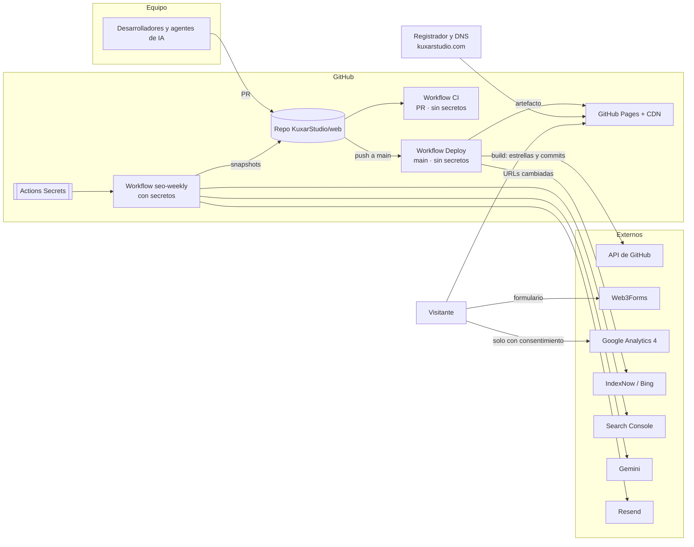

# Arquitectura de seguridad

Cómo está montado el sistema, dónde están los límites de confianza y qué
decisiones de diseño lo mantienen seguro. Los requisitos que se citan (`SR-xx`)
están en [security-requirements.md](security-requirements.md).

## 1. Principio rector: estático primero

La web no tiene servidor propio. Astro genera HTML, CSS y JS en el build y
GitHub Pages los sirve desde su CDN. Esto elimina de raíz las clases de ataque
más comunes (inyección SQL, robo de sesiones, ejecución remota en servidor) y
deja la superficie de ataque en cuatro sitios:

1. Las **cuentas** que pueden cambiar el código o el DNS.
2. El **pipeline** de build (dependencias y GitHub Actions).
3. Los **servicios externos** a los que llama el navegador.
4. El **agente SEO**, el único componente con secretos.

## 2. Vista general

## 3. Componentes

### 3.1 Web (`web/`)

- **Qué es:** sitio Astro estático, servido en `https://kuxarstudio.com` por
  GitHub Pages (CNAME en `web/public/CNAME`).
- **Datos en build time:** `src/lib/github.ts` consulta la API de GitHub con el
  `GITHUB_TOKEN` del job (solo lectura) para pintar estrellas y último commit.
  Si la API falla, la web se genera sin esos datos.
- **Datos en el navegador:**
  - Formulario de contacto → `api.web3forms.com` con una access key pública
    (SR-02). Honeypot `website` para bots (SR-18).
  - GA4 → solo se carga si `PUBLIC_GA_ID` existe **y** el visitante aceptó en el
    banner (`localStorage: kuxar-consent`). SR-15, SR-20.
  - Tema e idioma → `localStorage`, sin datos personales.
- **Contenido:** Markdown del repo (`src/content/`). `set:html` solo con ese
  contenido o JSON-LD generado con `JSON.stringify` (SR-14).
- **Fuentes:** autoalojadas, sin peticiones a Google Fonts.
- **Cabeceras:** GitHub Pages no permite cabeceras propias. HTTPS y HSTS los
  pone GitHub. Una CSP solo puede declararse con `<meta http-equiv>` (SR-16;
  `frame-ancestors` no funciona por esa vía).

### 3.2 Pipeline (`.github/workflows/`)

| Workflow | Disparador | Permisos | Secretos | Código no confiable |
|---|---|---|---|---|
| `ci.yml` | `pull_request` | `contents: read` | Ninguno (`GITHUB_TOKEN` de solo lectura) | Sí (PR de forks) → por eso sin secretos |
| `deploy.yml` → `build` | push a `main`, manual | `contents: read` | Ninguno | No |
| `deploy.yml` → `deploy` | tras `build` | `pages: write`, `id-token: write` | Ninguno (OIDC) | No: solo despliega el artefacto |
| `deploy.yml` → `indexnow` | tras `deploy` | `contents: read` | Ninguno (la clave IndexNow es pública) | No |
| `seo-weekly.yml` | cron semanal, manual | `contents: write` | Los 4 del agente SEO | No: solo `main` |

Decisiones clave:

- **Los secretos solo existen en `seo-weekly`**, que nunca corre con código de
  un PR. El build de la web no tiene ningún secreto que robar.
- `persist-credentials: false` en todos los checkouts: el token no queda en
  `.git/config` para pasos posteriores.
- `seo-weekly` escribe solo en la rama `seo-data`, que no dispara despliegues.
- El deploy usa OIDC (`id-token: write`), no un token de larga duración.
- Node 22 con `check-latest`; dependencias con `npm ci` desde el lockfile.

### 3.3 Agente SEO (`tools/seo-agent`)

Python con tres dependencias de primer nivel. Lee Search Console con una cuenta
de servicio de solo lectura, consulta Gemini y envía el informe por Resend. Es
el componente más sensible del repo: concentra los secretos y ejecuta
dependencias de PyPI con ellos cargados (amenaza T05). Por eso sus dependencias
se mantienen al mínimo.

### 3.4 Dominio y correo

- `kuxarstudio.com` apunta a GitHub Pages. Debe estar verificado en la org de
  GitHub (SR-24) para que ningún otro repo pueda reclamarlo.
- El correo (`admin@`, `seo@`) usa Resend para envíos automáticos, con DKIM
  verificado. Falta confirmar la política DMARC (SR-25).

## 4. Datos personales

| Dato | Dónde se recoge | Dónde va | Retención |
|---|---|---|---|
| Nombre, email y mensaje de contacto | Formulario | Web3Forms → bandeja del estudio | La de la bandeja de correo |
| Datos de navegación | GA4, solo con consentimiento | Google Analytics | La configurada en GA4 |
| Consentimiento, tema, idioma | Navegador | `localStorage` del visitante | Hasta que el visitante lo borre |
| Métricas agregadas de búsqueda | Search Console | Rama `seo-data` (pública) | Indefinida; sin datos personales |

La web no guarda datos personales en ningún sistema propio.

## 5. Cómo crecer sin romper esto

Cuando llegue un backend (Parte, rankings de BlindNote, APIs del estudio):

- **La web sigue siendo estática.** Llama al backend desde el navegador con
  `fetch` a una API pública con CORS restringido a `kuxarstudio.com`. Nada de
  convertir `web/` en una app con servidor solo para un formulario.
- **Repo y despliegue separados** (SR-26), con sus propios secretos y su
  workflow. Un fallo en la web no debe dar acceso al backend, ni al revés.
- **Opciones gratuitas o baratas que encajan:** Firebase (Auth + Firestore con
  reglas que deniegan por defecto) o Supabase (Auth + Postgres con Row Level
  Security) para apps; Cloudflare Workers o Cloud Run para una API ligera.
  Todos dan HTTPS, gestión de secretos y planes gratuitos.
- **Las apps móviles** (Flutter, Godot) se tratan como clientes públicos: todo
  lo que llevan dentro se puede extraer (SR-30). La seguridad está en las reglas
  del servidor.
- **No mezclar claves:** las `PUBLIC_*` de Astro nunca sirven para un backend.
  Si la web necesita una clave privada, ese código va en el backend.

Si una decisión de la web va a limitar este modelo (por ejemplo, meter lógica
de servidor en el sitio de Pages o compartir secretos entre proyectos), se
anota aquí y en el [modelo de amenazas](threat-model.md) antes de hacerla.
